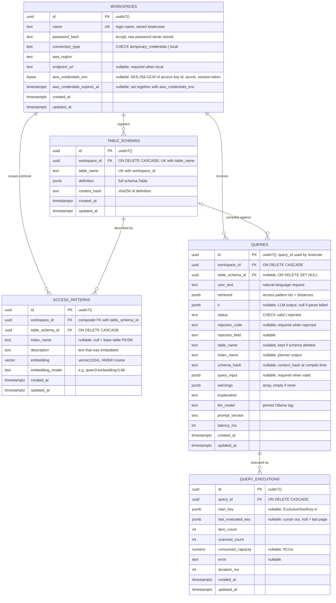

# Postgres ERD

App data only. DynamoDB Local is the demo customer database, never app storage. Tables are created by goose migrations in `server/migrations/`.

## Notes

- **Deletes are hard.** No `deleted_at`. Child rows go with `ON DELETE CASCADE`; `queries.table_schema_id` is `SET NULL` so history survives a schema delete.
- **`updated_at`** is maintained by the shared `set_updated_at()` trigger on every table, not by app code.
- **Login:** workspace `name` + password, checked against `password_hash`. Sessions are JWTs (not stored).
- **AWS credentials (Phase 1):** the user pastes temporary credentials (`ASIA...` key with a session token; long-lived `AKIA...` keys are rejected). They are encrypted with AES-256-GCM using `CREDENTIALS_ENCRYPTION_KEY`, with `workspace_id` as additional authenticated data, and decrypted only in memory per execute. Expired credentials return `credentials_expired`. AssumeRole (`role_arn` + `external_id`) replaces this later as a new `connection_type`.
- **`access_patterns.workspace_id`** is denormalized so retrieval filters by workspace without a join. The composite FK to `table_schemas (id, workspace_id)` guarantees it always matches the schema's workspace.
- **Execute guard:** before running a saved query, `queries.schema_hash` must equal the current `table_schemas.content_hash`; otherwise the schema changed and the query is rejected.
- **No query results are stored.** `query_executions` keeps counts and cursors only.
